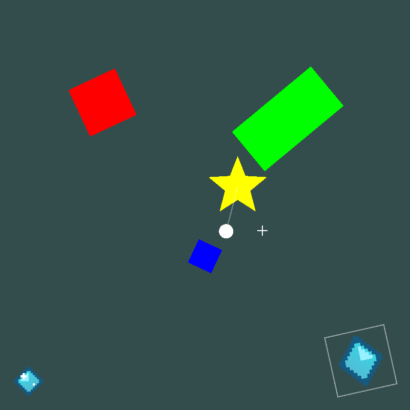

# Evil Engine

Our own 2D game engine for C# on OpenGL 3.3.

It started as **MyGameFrameWork**, a small project to learn how rendering works before the internship at AZTEQ,
inspired by [MonoGame](https://monogame.net/). One thing about MonoGame I did not like: every draw puts the
origin back at `(0, 0)`. The idea here is the opposite: things drawn in a **group** stay together and follow
their parent's move, turn and scale. That idea is still the heart of the engine; the rest grew around it.



## A game in a few lines

```csharp
GameBuilder.Create(new WindowSettings("Hello", 800, 600))
    .Content(Path.Combine(AppContext.BaseDirectory, "Content"))
    .Start(new HelloScene())
    .Build()
    .Run();

internal sealed class HelloScene : Scene
{
    private float _angle;

    protected override void Update(GameTime time) => _angle += 90f * time.DeltaSeconds;

    protected override void Draw(Canvas canvas)
    {
        using var group = canvas.Group();
        canvas.Translate(canvas.Size / 2f);
        canvas.Rotate(_angle);
        canvas.FillRect(new RectF(-50f, -50f, 100f, 100f), Color.Red);
    }
}
```

## What is inside

| Package | Namespaces | What |
|---|---|---|
| `Evil.Engine.Mathematics` | `Evil.Engine.Mathematics` | rectangles, angles, `Transform2D`, the grouped `TransformStack`, polygons with triangulation and hit tests; no dependencies |
| `Evil.Engine` | `Hosting` | `GameBuilder` (values only), `GameHost`, `GameContext`, `GameTime`, capture-and-exit |
| | `Scenes` | `Scene` with enter, update, draw, pause, resume, exit; a stack with overlays |
| | `Graphics` | `Canvas`: groups, rectangles, lines, circles, polygons, sprites, in one batched draw call; `Color` |
| | `Textures` | `TextureLibrary`, `Texture2D`, `TextureRegion` and sprite sheet grids |
| | `Input` | `Keyboard`, `Mouse`, `Key`, `MouseButton`; taps shorter than a frame are kept |
| | `Capture` | `PngEncoder`; `Game.CaptureFrame(path)` saves the frame on screen |

## Layout

```
src/Evil.Engine.Mathematics   the math, no dependencies
src/Evil.Engine               the engine
samples/Evil.Engine.Sample    the old demo on the new engine, plus sprites, picking and a pause overlay
tests/Evil.Engine.Tests       the test runner (dotnet tests/.../Evil.Engine.Tests.dll)
scripts/check.sh              build, tests, a screenshot and a run driven with real keys and mouse
scripts/pack.sh               packs both packages into the folder feed
documents/                    the docs (Obsidian vault): start at documents/Home.md
```

## Run

```bash
dotnet run --project samples/Evil.Engine.Sample
./scripts/check.sh
```

Space stops the spin, Up and Down change the speed, P pauses, F12 saves a screenshot, Escape quits.

## Docs

Start at [documents/Home.md](documents/Home.md). [From MyGameFrameWork](documents/From%20MyGameFrameWork.md)
maps every old call to the new one and lists what got fixed. The original code is commit `8b1fb3f`.
