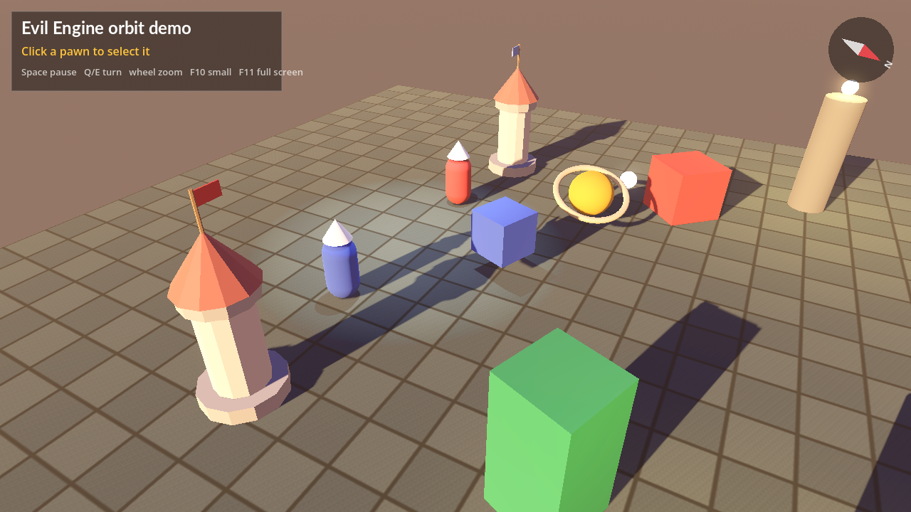

# Evil Engine

Our own game engine SDK for C#, for a full 3D game, built as clean class libraries on top of
[Godot 4.7.2](https://godotengine.org/) (.NET). Godot renders; a game talks only to our API: world objects,
cameras, lights, the screen, scenes and the game builder.

It started as **MyGameFrameWork**, a small OpenGL project to learn how rendering works before the internship at
AZTEQ, inspired by [MonoGame](https://monogame.net/). What I did not like in MonoGame was that every draw puts
the origin back at `(0, 0)`. The idea here is the opposite: things in a **group** stay together and follow their
parent's move, turn and scale. That idea is still the heart of the engine, now in 3D. The 2D OpenTK version is
tag `v0.1.0`.



## A game

```csharp
public partial class Main : GameMain
{
    protected override GameHost CreateGame() =>
        GameBuilder.Create(new WindowSettings("Orbit", 1280, 720))
            .Start(new OrbitScene())
            .Build();
}

internal sealed class OrbitScene : Scene
{
    private Box? _blue;

    protected override void Enter()
    {
        Camera.Position = new Vector3(0f, 7f, 11f);
        Camera.LookAt(Vector3.Zero);
        Atmosphere = Atmosphere.Dusk();
        World.Add(Sun.Golden());

        _blue = World.Add(new Box(Vector3.One, Color.FromHex("#3E63DD")));
        var yellow = _blue.Add(new Sphere(0.55f, Color.FromHex("#FFC53D")));
        yellow.Position = new Vector3(3f, 0f, 0f);
    }

    protected override void Update(GameTime time) => _blue!.RotateY(-50f * time.DeltaSeconds);
}
```

## Layout

```
src/00_Core          Evil.Engine.Core           GameTime, Color (no dependencies)
src/01_Mathematics   Evil.Engine.Mathematics    math, transform stacks, polygons (no dependencies)
src/02_Platform      Evil.Engine.Platform       the Godot glue, internal to the SDK
src/03_World         Evil.Engine.World          WorldObject groups, shapes, materials, textures, models
src/04_Cameras       Evil.Engine.Cameras        Camera
src/05_Lighting      Evil.Engine.Lighting       Sun
src/07_Screen        Evil.Engine.Screen         display, frame capture, 2D overlay canvas with text
src/08_Motion        Evil.Engine.Motion         moves, hops, turns, fades, queued per object
src/09_Engine        Evil.Engine                GameBuilder, GameMain, scenes
samples/OrbitDemo                               a Godot project using only our API
tests/Evil.Engine.Tests                         pure tests (Core, Mathematics)
tests/Evil.Engine.GodotTests                    tests that run inside Godot against real nodes
documents/                                      docs (Obsidian vault): start at documents/Home.md
```

More libraries land round by round: see [documents/LOOP.md](documents/LOOP.md).

## Run

```bash
./scripts/check.sh                          # build, tests, the demo in Godot, a screenshot
bash scripts/godot.sh samples/OrbitDemo     # the demo on a machine without a screen
```

On a desktop, open `samples/OrbitDemo` in Godot 4.7.2 (.NET) and press play. Space pauses, Q and E turn the
camera, the wheel zooms, right-drag orbits, hover and click a pawn to select it, then pick an action in the
bar; F10 shrinks the window, F11 toggles full screen, F12 saves a screenshot.
