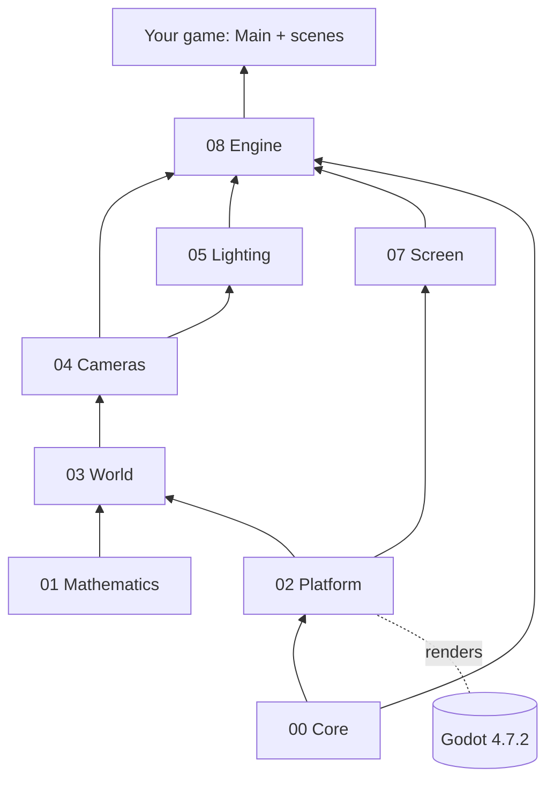

# Architecture Overview

## The libraries

Each folder holds one class library. Numbers show the order: a library only uses libraries with a lower
number.

| Folder | Library | What | Uses Godot |
|---|---|---|---|
| `src/00_Core` | `Evil.Engine.Core` | `GameTime`, `Color` | no |
| `src/01_Mathematics` | `Evil.Engine.Mathematics` | 2D and 3D math: poses, rotations, rays, bounds, orbit, smoothing, polygons | no |
| `src/02_Platform` | `Evil.Engine.Platform` | the one place that converts our types to Godot's and back | inside |
| `src/03_World` | `Evil.Engine.World` | `WorldObject` (3D group), seven shapes, `Material` | inside |
| `src/04_Cameras` | `Evil.Engine.Cameras` | `Camera`, `OrbitCamera`, screen rays | inside |
| `src/05_Lighting` | `Evil.Engine.Lighting` | `Sun`, `Lamp`, `Spotlight`, `Atmosphere` | inside |
| `src/06_Input` | `Evil.Engine.Input` | keyboard, mouse, picking (round 6) | inside |
| `src/07_Screen` | `Evil.Engine.Screen` | `WindowSettings`, frame capture, overlay later | inside |
| `src/08_Engine` | `Evil.Engine` | `GameBuilder`, `GameMain`, `GameContext`, `Scene`, `SceneStack` | inside |

"Inside" means Godot types never show in the public API: a game sees Evil Engine types and `System.Numerics`
vectors only. Wrappers keep their Godot node `internal`, and the constructors that take one are
`private protected`.

## How a game starts

1. Godot opens the game's `main.tscn`. Its root node runs `Main.cs`, the game's one Godot-facing line:
   `public partial class Main : GameMain`.
2. `GameMain._Ready` calls the game's `CreateGame()`, which builds the game with values ([[Decisions]] 13).
3. It sets the window, the background colour, a `Worlds` node, and pushes the first scene.
4. Every frame `_Process` updates the top scene and applies scene changes. After Godot has drawn the frame
   (`RenderingServer.FramePostDraw`), requested captures are saved and the game quits if it was asked to.

## Scenes own a world

Each scene on the stack gets its own `World` (a `WorldObject` under `Worlds`), its own `Camera` inside it and its
own `Atmosphere` shown through that camera.
Popping a scene frees its world. A full scene hides the worlds below it; an overlay keeps them visible. The
camera of the lowest visible scene is the one the screen shows.

## Godot build notes

| Where | Setting | Why |
|---|---|---|
| `src/Godot.props` (libraries) | `GodotDisabledSourceGenerators=ScriptPathAttribute;GodotPluginsInitializer` | those generators are for the game project only |
| `src/Godot.props` | `NoWarn CS0436` | Godot still generates an internal `GodotPlugins.Game.Main` per library, and our libraries see each other's internals |
| game projects | `ManagePackageVersionsCentrally=false` | `Godot.NET.Sdk/4.7.2` adds and pins its own packages |
| server runs | `--rendering-method gl_compatibility --rendering-driver opengl3` under xvfb | llvmpipe offers OpenGL, not Vulkan; on the PC Godot uses Forward+ |
| `scripts/godot.sh` | `systemd-run ... MemoryMax=2G` | the server has 11 GiB for everything |
