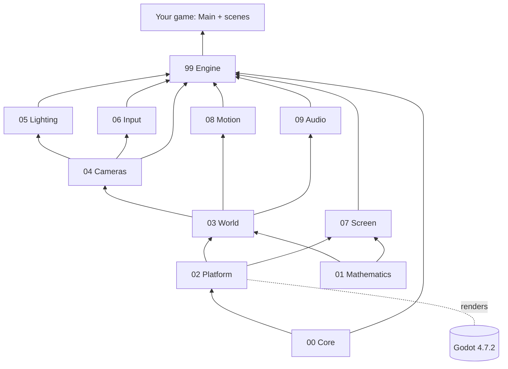

# Architecture Overview

## The libraries

Each folder holds one class library. Numbers show the order: a library only uses libraries with a lower
number.

| Folder | Library | What | Uses Godot |
|---|---|---|---|
| `src/00_Core` | `Evil.Engine.Core` | `GameTime`, `Color`, `Easing` | no |
| `src/01_Mathematics` | `Evil.Engine.Mathematics` | 2D and 3D math: poses, rotations, rays, bounds, orbit, smoothing, polygons | no |
| `src/02_Platform` | `Evil.Engine.Platform` | the one place that converts our types to Godot's and back | inside |
| `src/03_World` | `Evil.Engine.World` | `WorldObject` (3D group), seven shapes, `Material`, `Texture`, `Model` | inside |
| `src/04_Cameras` | `Evil.Engine.Cameras` | `Camera`, `OrbitCamera`, screen rays | inside |
| `src/05_Lighting` | `Evil.Engine.Lighting` | `Sun`, `Lamp`, `Spotlight`, `Atmosphere` | inside |
| `src/06_Input` | `Evil.Engine.Input` | `Keyboard`, `Mouse`, `Picker` | inside |
| `src/07_Screen` | `Evil.Engine.Screen` | `WindowSettings`, `Display`, frame capture, `Canvas` overlay with text | inside |
| `src/08_Motion` | `Evil.Engine.Motion` | `MotionPlayer`, `Tween` (queued per object) | no Godot types used |
| `src/09_Audio` | `Evil.Engine.Audio` | `AudioMixer`, `Sound`, volume groups, recording | inside |
| `src/99_Engine` | `Evil.Engine` | `GameBuilder`, `GameMain`, `GameContext`, `Scene`, `SceneStack` | inside |

"Inside" means Godot types never show in the public API: a game sees Evil Engine types and `System.Numerics`
vectors only. Wrappers keep their Godot node `internal`, and the constructors that take one are
`private protected`.

## Inside each library

One type per file, named after it. A library with more than a handful of files groups them in folders by meaning;
the folders do not change the namespace, so `using Evil.Engine.World;` still reaches every shape.

| Library | Folders |
|---|---|
| Core, Platform, Cameras, Audio | none: four or five files each |
| Mathematics | `2D/` (rects, Transform2D, the transform stack, polygons, triangulation by an `EarClipper` that owns the polygon it cuts), `3D/` (Pose, Rotations, Bounds3, Ray3 with its `Interval` slabs, Orbit); `Angle`, `Smoothing` and the `Finite` validators at the root, used by both |
| World | `Objects/` (WorldObject, MeshObject, ShapeObject), `Shapes/` (the seven shapes and `RoundShape` under Cylinder and Cone), `Materials/` (Material, Texture), `Models/` (Model, ModelPart) |
| Lighting | `Lights/` (Light, Sun, Lamp, Spotlight), `Atmosphere/` (Atmosphere, the four backgrounds, Fog, ToneMapping) |
| Input | `Keyboard/` (Key, Keyboard, the Godot key table derived from the names), `Mouse/` (Mouse, MouseButton), `Picking/` (Picker, Hit); at the root `ButtonStates` (what is down, pressed, released; used by both devices) and `InputFeed` |
| Screen | `Window/` (WindowSettings, WindowSetup, Display), `Canvas/` (Canvas, Font, TextAlign, the canvas targets), `Overlay/` (the overlay node and painter), `Capture/` (FrameCapture) |
| Motion | `Tweens/` (Tween, ValueTween and one file per object tween); at the root `MotionPlayer`, which routes calls to a `TweenQueue` per object and the `LooseTweens` of `Value()`, both a `TweenGroup` |
| Engine | `Hosting/` (builder, host, context, GameMain, options), `Content/` (ContentLibrary, ContentLocation, the `ContentLoader` base; `Loaders/` one per kind: textures, fonts, sounds, scenes, models; `SoundFormats/` wav and ogg), `Scenes/` (Scene, SceneStack, scene changes) |

## How a game starts

1. Godot opens the game's `main.tscn`. Its root node runs `Main.cs`, the game's one Godot-facing line:
   `public partial class Main : GameMain`.
2. `GameMain._Ready` calls the game's `CreateGame()`, which builds the game with values ([[Decisions]] 13).
3. It sets the window, the background colour, a `Worlds` node, an `Audio` node, the 2D overlay layer, and pushes
   the first scene.
4. Godot's input events go to `Keyboard` and `Mouse` as they arrive ([[Input]]).
5. Every frame `_Process` updates the top scene, applies scene changes, clears the frame's key presses, moves the
   tweens ([[Motion]]) and the music fades ([[Audio]]), and asks the overlay to redraw. Godot then draws the 3D
   world and calls each visible scene's `Draw(Canvas)` ([[Screen]]).
6. After Godot has drawn the frame (`RenderingServer.FramePostDraw`), requested captures are saved.
7. Quitting (`Game.Exit()`, the last scene popped, a capture-and-exit, or the window's close button) stops all audio
   first and quits three frames later, then frees the content it loaded, so nothing is left behind at exit.

## Scenes own a world

Each scene on the stack gets its own `World` (a `WorldObject` under `Worlds`), its own `Camera` inside it and its
own `Atmosphere` shown through that camera.
Popping a scene frees its world. A full scene hides the worlds below it; an overlay keeps them visible. The
camera of the lowest visible scene is the one the screen shows.

## Godot build notes

| Where | Setting | Why |
|---|---|---|
| `src/Godot.props` (libraries) | `GodotDisabledSourceGenerators=ScriptPathAttribute;GodotPluginsInitializer` | those generators are for the game project only |
| `src/Godot.props` | `NoWarn CS0436` | Godot still generates an internal `GodotPlugins.Game.Main` per library, and our libraries see each other's internals |
| game projects | `ManagePackageVersionsCentrally=false` | `Godot.NET.Sdk/4.7.2` adds and pins its own packages |
| server runs | `--rendering-method gl_compatibility --rendering-driver opengl3` under xvfb | llvmpipe offers OpenGL, not Vulkan; on the PC Godot uses Forward+ |
| `scripts/godot.sh` | `systemd-run ... MemoryMax=2G` | the server has 11 GiB for everything |
