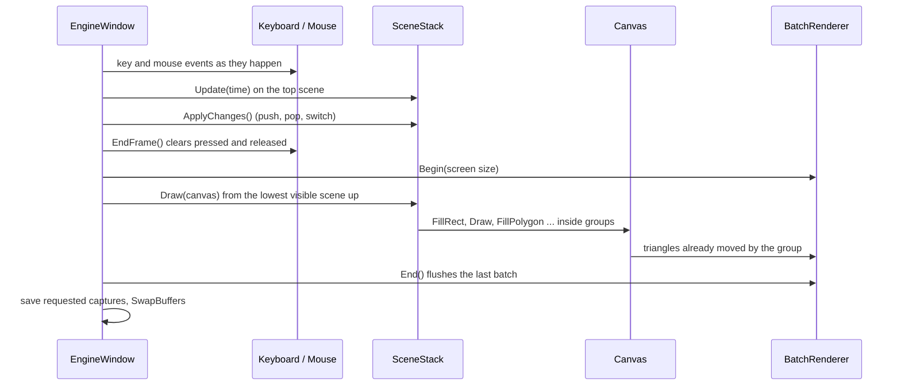

# Architecture Overview

## Packages and folders

```
src/
  Evil.Engine.Mathematics/      no dependencies
    Angle  RectF  RectI  Transform2D  TransformStack  TransformScope  Polygon  Triangulator
  Evil.Engine/                  OpenTK 4.9.4 + StbImageSharp 2.30.16
    Hosting/    GameBuilder  GameHost  GameContext  GameTime  WindowSettings  (EngineWindow, GameOptions)
    Scenes/     Scene  SceneStack
    Graphics/   Canvas  Color  (BatchRenderer, ShaderProgram, Vertex, Shaders/*.glsl embedded)
    Textures/   Texture2D  TextureRegion  TextureLibrary  TextureFilter  (ImageDecoder)
    Input/      Keyboard  Mouse  Key  MouseButton
    Capture/    PngEncoder  (FrameCapture, Crc32)
samples/Evil.Engine.Sample/    the demo game
tests/Evil.Engine.Tests/       the test runner
scripts/                       check.sh, drive.sh, pack.sh
```

Names in brackets are `internal`: a game never sees OpenGL or OpenTK. One folder is one namespace.

> [!important] Math stays out there
> `Evil.Engine.Mathematics` has no reference to OpenGL. The turn-based game's rules (a pure C# library that
> runs in tests on the server) can use rectangles, transforms and polygons without a window.

## One frame



## Who owns what

| Thing | Owner | Freed |
|---|---|---|
| window, GL context | `GameHost.Run` | when `Run` returns |
| renderer, shader, white texture | `EngineWindow` | on unload |
| loaded and created textures | `TextureLibrary` (`Game.Textures`) | `Unload(texture)` or when the game ends |
| scenes | `SceneStack` | `Exit()` runs when a scene leaves and when the game ends |

See [[Rendering]] for the draw path and [[Grouped Transforms]] for the math behind groups.
