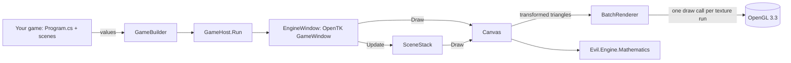

# Evil Engine

Our own 2D game engine for C#. It grew out of **MyGameFrameWork**, the OpenGL framework built to get ready
for the AZTEQ internship, and keeps its main idea: things you draw stay grouped and follow their parent, so a
moon follows its planet without you working out where the planet went.

It ships as two packages:

- **`Evil.Engine.Mathematics`**: rectangles, angles, transforms, the grouped transform stack and polygons.
  No dependencies, so game rules and tests can use it without a window.
- **`Evil.Engine`**: the game builder, scenes, the canvas, textures and sprite regions, keyboard and mouse,
  frame capture. Runs on OpenGL 3.3 through OpenTK.

> [!tip] New here?
> Read [[Make a Game]] for the 20 lines that open a window, then [[Run the Sample]].

![[sample.png]]

## Map

| Area | Notes |
|---|---|
| Getting started | [[Make a Game]] · [[Run the Sample]] |
| Architecture | [[Architecture Overview]] · [[Grouped Transforms]] · [[Rendering]] |
| API | [[Game Builder]] · [[Scenes]] · [[Canvas]] · [[Textures]] · [[Input]] · [[Mathematics]] |
| Where it came from | [[From MyGameFrameWork]] |
| Why it is built this way | [[Decisions]] |

## The whole thing in one picture

## Finding a change point

| I want to... | Go to |
|---|---|
| change what the window or loop does | `src/Evil.Engine/Hosting/` and [[Game Builder]] |
| add a drawing call (a new shape) | `src/Evil.Engine/Graphics/Canvas.cs` and [[Canvas]] |
| change how textures load or cut | `src/Evil.Engine/Textures/` and [[Textures]] |
| add a key or a mouse feature | `src/Evil.Engine/Input/` and [[Input]] |
| add math that game rules also need | `src/Evil.Engine.Mathematics/` and [[Mathematics]] |
| prove a change works | `scripts/check.sh` (see [[Run the Sample]]) |
